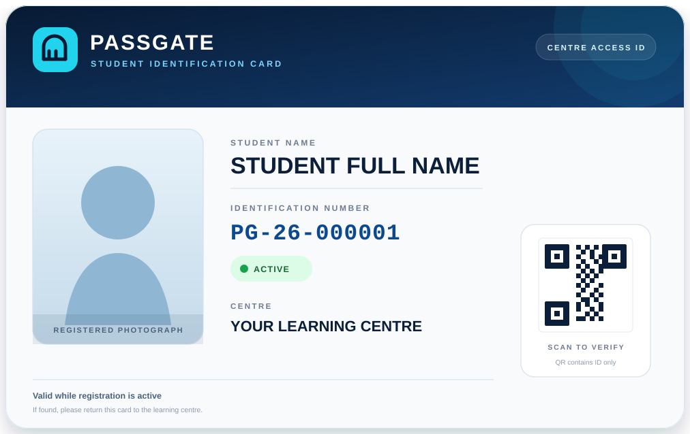
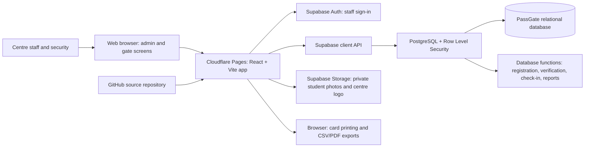
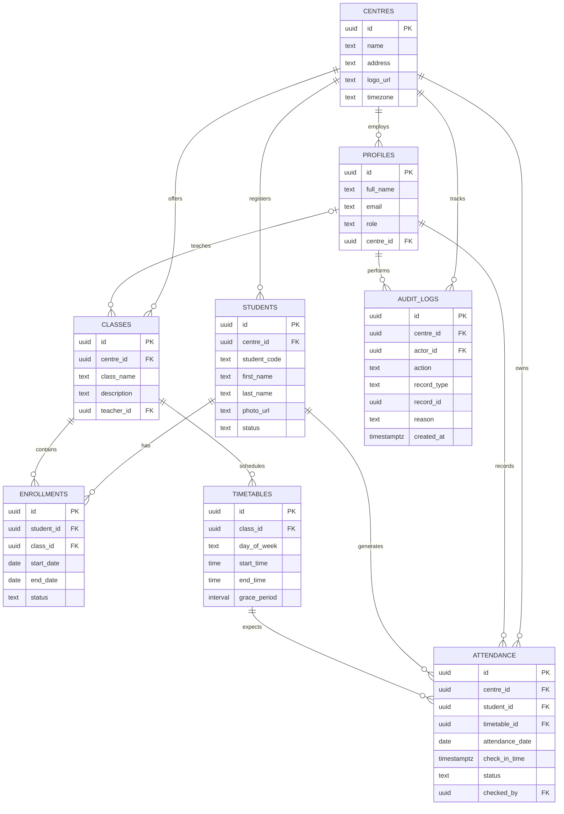
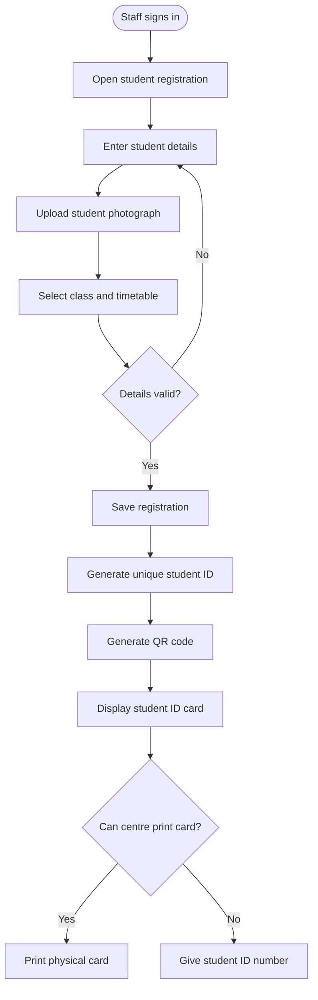
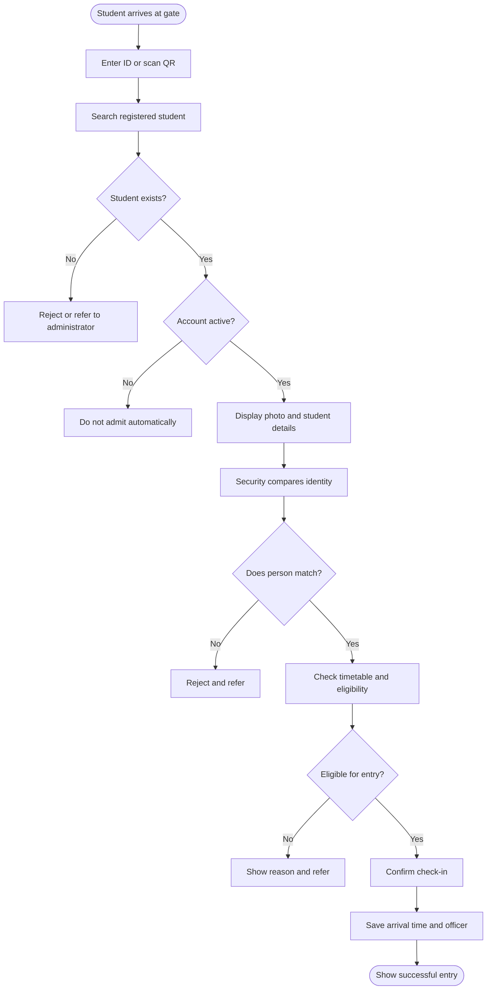
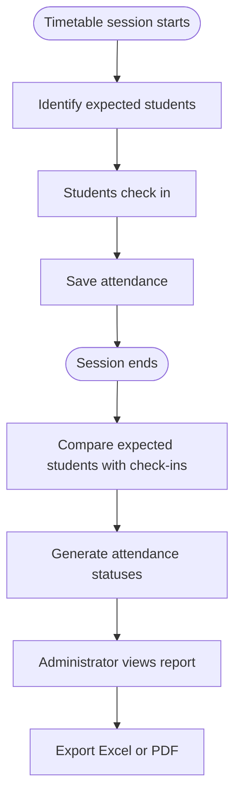

# PassGate — Complete MVP Software Requirements & Development Blueprint

**Student Registration, Identification & Centre Entry Management System**

`Zero-budget MVP` · `Web application` · `Version 1.0`

> [!IMPORTANT]
> **The centre must identify a student before allowing entry.** PassGate combines student identity management with security gate management, and never treats a QR code or student number as proof of identity by itself.

PassGate has two connected functions:

1. **Student identity management** — register students, generate permanent IDs, create student profiles and print physical identification cards.
2. **Security gate management** — let security staff scan a QR code or enter an ID number, retrieve the student's registered information, compare the person with the profile and record their arrival.

The system is designed for one learning centre first, with an architecture that can later support multiple centres.

### Requirements from the original project chat

| Request | Where it is covered |
| --- | --- |
| Keep normal operation free within free-tier limits | Sections 1, 13, and 14 |
| Staff register students and receive a generated student ID | Sections 4, 6, 7, and 14 |
| Search by manually entered ID or scan a QR code | Sections 2, 5, 10, and 14 |
| Show student details so security can verify identity | Sections 2, 5, 10, and 14 |
| Print an ID card when possible; allow an ID number when not | Sections 3, 10, 14, and 15 |
| Record attendance as check-in only | Sections 8, 9, and 14 |
| Support centre-defined classes and timetables | Sections 8, 9, and 14 |
| Include diagrams/graphs for the system | Architecture, entity-relationship, and workflow diagrams in Sections 9 and 10 |

> [!IMPORTANT]
> An ID or QR match retrieves the student's record; it does not by itself establish that the person presenting it is the student. Security must compare the displayed profile with the person before confirming entry.

## Contents

1. [Recommended technology and zero-budget strategy](#1-recommended-technology-and-zero-budget-strategy)
2. [Product scope and objectives](#2-product-scope-and-objectives)
3. [Student ID card design](#3-student-id-card-design)
4. [Complete user roles and permissions](#4-complete-user-roles-and-permissions)
5. [Main application screens](#5-main-application-screens)
6. [Student registration fields](#6-student-registration-fields)
7. [Unique student ID generation](#7-unique-student-id-generation)
8. [Attendance and timetable logic](#8-attendance-and-timetable-logic)
9. [Database architecture](#9-database-architecture)
10. [User flows](#10-user-flows)
11. [Security and privacy requirements](#11-security-and-privacy-requirements)
12. [Non-functional requirements](#12-non-functional-requirements)
13. [Development phases](#13-development-phases)
14. [Complete development prompt](#14-complete-development-prompt)
15. [Final recommendations before development](#15-final-recommendations-before-development)
16. [Official resources](#official-resources)
17. [Suggested next milestone](#suggested-next-milestone)

## 1. Recommended technology and zero-budget strategy

### Recommended backend: Supabase

**Supabase** is the recommended backend because PassGate has connected records: students, classes, timetables, security users and attendance. PostgreSQL makes these relationships easier to manage, and Supabase provides the database, authentication and file storage in one free-tier project.

**Technology stack**

| Area | Technology |
| --- | --- |
| Frontend | React + Vite |
| Language | JavaScript |
| Styling | Tailwind CSS |
| Database | Supabase PostgreSQL |
| Authentication | Supabase Auth |
| Student photos and card images | Supabase Storage |
| Hosting | Cloudflare Pages Free |
| QR codes | Free JavaScript QR library |
| QR scanning | Free browser-camera scanning library |
| Reports | Excel/CSV and PDF generation in the browser |
| Version control | GitHub |

### Supabase Free Plan snapshot

| Free resource | Supabase Free |
| --- | --- |
| Database | 500 MB |
| File storage | 1 GB |
| Monthly active users | 50,000 |
| API requests | Unlimited |
| Edge Function invocations | 500,000 |
| Monthly price | $0 |

> [!WARNING]
> Free-tier limits and terms can change. The figures above are taken from the source note and should be re-verified before launch. Supabase free projects can pause after one week of inactivity, and automatic backups are not included.

### Alternative: Firebase Spark

Firebase Spark is also a good alternative and requires no payment method. Its standard free quota includes 20,000 Firestore writes and 50,000 reads per day. It is a viable fallback, but this blueprint standardizes on Supabase for the MVP.

> [!IMPORTANT]
> **Decision:** Use Supabase for this MVP. Do not activate paid subscriptions, paid APIs, paid SMS or paid services. Configure the project to remain on its free plan.

No provider can promise unlimited permanent operation at $0. PassGate should monitor quotas and display warnings before limits are reached.

## 2. Product scope and objectives

### Main objectives

- Register every student only once.
- Automatically generate a unique student identification number.
- Produce a printable physical student ID card.
- Give students an alternative if they cannot afford or obtain a printed card: they can use their ID number.
- Allow security to search using either manual ID entry or QR scanning.
- Display the student's registered photograph and details.
- Allow security to verify the identity before admitting the student.
- Automatically record arrival date, time and class session.
- Identify students who were expected but did not attend.
- Give administrators attendance reports.

### Important security principle

> [!CAUTION]
> **A QR code or student number is an identification reference, not proof of identity by itself.**
>
> The security screen must show the registered photograph and name. The security officer compares these with the person standing at the entrance before confirming entry.

The system must never automatically admit someone merely because a QR code is valid.

## 3. Student ID card design

**Core MVP feature**

Every registered student should have a digital ID card that can be printed by the centre.

### Illustrative card front



*Illustrative layout only. The actual card uses the registered student's photograph, generated ID and working QR code.*

| Field | Required |
| --- | --- |
| Centre name | Yes |
| Centre logo | Optional |
| Student photograph | Recommended |
| Student full name | Yes |
| Unique student ID | Yes |
| QR code | Yes |
| Registration status | Yes |

### Printing requirements

- Printable PDF.
- Standard CR80 ID card dimensions: **85.60 × 53.98 mm**.
- Front-side card for the MVP.
- Print individual cards or multiple cards on A4 paper.
- Reprint lost or damaged cards.
- Generate a digital card that can be shown on a phone.
- If the centre cannot print cards, students receive their ID numbers.

The QR code should contain only the student's unique identification code, not private information.

## 4. Complete user roles and permissions

| Role | Permissions |
| --- | --- |
| Super Admin | Manage the system and centre settings |
| Centre Administrator | Register students, manage classes and view reports |
| Registration Staff | Register and update student profiles |
| Security Officer | Search, scan, verify identity and check students in |
| Teacher | View assigned classes and attendance |
| Student | No login required in the MVP |

> [!IMPORTANT]
> Each staff member must have an individual account. Do not share one security account among multiple guards, because attendance records should show who checked a student in.

## 5. Main application screens

### A. Admin dashboard

| Registered students | Present today | Not checked in | Active sessions |
| ---: | ---: | ---: | ---: |
| **250** | **180** | **30** | **3** |

*Illustrative dashboard with sample figures, not live centre data.*

### B. Security entrance screen

**Student verification:** scan a student QR code or enter their ID number.

| Student ID | **PG-26-000001** |
| --- | --- |
| Name | Student Full Name |
| ID | PG-26-000001 |
| Status | Active |
| Class | Computer Studies |
| Identity check | Details found — compare photo |

The guard must confirm that the person matches the registered photograph before selecting either action:

| Action | Effect |
| --- | --- |
| **Confirm entry** | Records the check-in against the officer's account |
| **Reject / refer** | Records no attendance and refers the student for assistance |

> [!CAUTION]
> A valid scan only retrieves a record. It must never produce an automatic entry confirmation.

### C. Student registration

- Personal details.
- Student photograph.
- Assigned class.
- Registration date.
- Generated identification number.
- Print ID card.

### D. Attendance reports

- Daily attendance.
- Expected versus attended students.
- Class attendance.
- Late arrivals.
- Individual student history.
- Monthly Excel/PDF exports.

## 6. Student registration fields

| Field | Requirement |
| --- | --- |
| First name | Required |
| Middle name | Optional |
| Last name | Required |
| Student photo | Recommended |
| Gender | Optional |
| Date of birth | Optional, if needed |
| Phone number | Optional |
| Emergency contact | Recommended |
| Course/program | Required |
| Class | Required |
| Registration date | Automatic |
| Student ID | Automatically generated |
| Registration status | Active by default |

> [!NOTE]
> Do not collect unnecessary personal information. Limit access to student records and photographs to authorized staff.

## 7. Unique student ID generation

The ID number must be generated automatically when staff completes registration.

```text
PG - 26 - 000001
│    │    └── Sequential number
│    └─────── Registration year
└──────────── PassGate
```

**Example student IDs**

- `PG-26-000001`
- `PG-26-000002`
- `PG-26-000003`
- `PG-26-000004`

### Technical rules

- Each ID must be unique.
- IDs must never be reused.
- Deleted or deactivated students retain their original ID.
- The ID is generated by a database transaction, not by the browser.
- Students must not be able to change their IDs.
- QR codes must use the same ID.
- Duplicate registration should be detected before generating a new number.

## 8. Attendance and timetable logic

The system supports custom timetables rather than only fixed morning, midday and afternoon sessions.

**Example timetable**

| Class | Days | Time |
| --- | --- | --- |
| Computer Basics | Mon–Fri | 9:00–11:00 |
| Graphic Design | Mon–Wed | 11:30–1:30 |
| Web Development | Tue–Thu | 2:00–4:00 |

Administrators can create and change these sessions.

### Attendance calculation

1. The administrator assigns students to classes.
2. The timetable identifies which students are expected in each session.
3. The security officer scans or enters the ID.
4. The system checks the student's active status and class enrolment.
5. It identifies the relevant scheduled session.
6. The security officer compares the photograph.
7. The officer confirms entry.
8. PassGate saves the check-in time and the officer's account.
9. At the end of the scheduled session, students who were expected but never checked in appear in the absence report.

### Attendance statuses

| Status | Meaning |
| --- | --- |
| **Present** | Successfully checked in |
| **Late** | Checked in after the configured grace period |
| **Absent** | Expected student did not check in before the session closed |
| **Not scheduled** | Student was not expected in that session |

> [!IMPORTANT]
> The selected MVP is **check-in only**. It does not require check-out. Absence is calculated from the timetable and attendance records, not from a missing departure time.

## 9. Database architecture

The database uses PostgreSQL through Supabase. The system uses relational tables so student registration, class assignments, schedules and attendance remain connected.

### Entity relationships

### System architecture



The browser application uses staff authentication and database policies for access control. Student photos stay in protected storage, while registration, ID generation, and check-in validation are handled by database-side logic. Card printing and report exports run in the browser to avoid adding a paid service.

### Entity relationships



### Database tables

| Table | Important fields |
| --- | --- |
| `centres` | id, name, address, logo_url, timezone |
| `profiles` | id, full_name, email, role, centre_id |
| `students` | id, centre_id, student_code, first_name, last_name, photo_url, status |
| `classes` | id, centre_id, class_name, description, teacher_id |
| `enrollments` | id, student_id, class_id, start_date, end_date, status |
| `timetables` | id, class_id, day_of_week, start_time, end_time, grace_period |
| `attendance` | id, centre_id, student_id, timetable_id, attendance_date, check_in_time, status, checked_by |
| `audit_logs` | id, centre_id, actor_id, action, record_type, record_id, reason, created_at |

### Additional database requirements

- Use UUID primary keys for internal records.
- Use a unique constraint on `(centre_id, student_code)`.
- Use a database sequence or atomic ID generator for student codes.
- Use a unique constraint on `(student_id, timetable_id, attendance_date)` to prevent duplicate attendance for a session.
- Store timestamps in UTC and display them in the centre's local timezone, **Africa/Nairobi**.
- Use foreign keys to protect relationships.
- Never physically delete attendance history when a student leaves.
- Index student codes and other frequently filtered columns.

### ID generation and attendance functions

Use PostgreSQL database functions for important operations:

| Function | Responsibility |
| --- | --- |
| `register_student()` | Validates and registers a student, then generates an ID |
| `verify_student_code()` | Checks whether the ID belongs to an active student and returns permitted details |
| `check_in_student()` | Validates the student, class, timetable and duplicate attendance, then records entry |
| `get_expected_students()` | Returns students expected in a given class session |
| `generate_attendance_report()` | Calculates present, late and absent counts |

Use database transactions for registration and check-in so simultaneous actions cannot create duplicate IDs or duplicate attendance. Supabase supports PostgreSQL transactions and database constraints. Firebase also provides atomic transactions as an alternative.

## 10. User flows

### Flow A: Register a new student



### Flow B: Student enters the centre



The reject, inactive and not-eligible paths must not create an attendance record. Only the officer's explicit confirmation after a visual identity check creates a check-in.

### Flow C: Daily attendance reporting



### Flow D: Lost ID card

1. Student reports the lost card.
2. Staff searches the student record.
3. Staff verifies the student.
4. Staff can print a replacement card.
5. The original student ID remains unchanged.
6. The QR code remains valid unless the student record is compromised.
7. If there is suspected misuse, an administrator can revoke the old QR token and issue a replacement while retaining the student's permanent ID number.

## 11. Security and privacy requirements

This is an important part of PassGate because it controls entry to a learning centre.

| Security feature | Requirement |
| --- | --- |
| Login | Staff-only authentication |
| Roles | Admin, registration, security, teacher |
| Database access | Row Level Security (RLS) |
| ID verification | Registered profile and photo |
| QR code | No private information encoded |
| Attendance | Only authorized staff can create records |
| Duplicate check-in | Blocked by database constraints |
| Audit trail | Record staff actions |
| Student deletion | Soft deactivation |
| Data protection | Secure photo and document storage |

### Security restrictions

- Do not expose the Supabase service-role key in React.
- Use the public anon/publishable key only with properly configured RLS.
- Only authorized staff should retrieve student photographs.
- Security officers must not edit student profiles.
- Teachers should only see their assigned classes.
- Administrators should be able to suspend an account.
- A student with an inactive registration must not receive a successful entry confirmation.
- All manual overrides must require a reason and be logged.
- For the MVP, security staff must be logged in. Do not make the student search endpoint publicly accessible without authentication.

## 12. Non-functional requirements

| Requirement | Target |
| --- | --- |
| Capacity | Initially 1,000 students |
| Staff users | Support centre staff accounts |
| Device support | Desktop, tablet and mobile |
| Interface | Responsive |
| Search | Fast student ID lookup |
| QR scanning | Camera-based scanning |
| Performance | Aim for under 2 seconds for normal lookups |
| Database | PostgreSQL |
| Timezone | Africa/Nairobi |
| Availability | Dependent on free hosting and database service |
| Backups | Manual scheduled CSV/database exports |
| Accessibility | Clear buttons and readable text |

A 1,000-student centre should be a reasonable starting use case for the proposed free tiers, provided that usage and storage stay within their quotas. It is not a guarantee of unlimited scale or uptime.

## 13. Development phases

| Phase | Work | Priority |
| --- | --- | --- |
| 1 | Project setup, database and authentication | Critical |
| 2 | Student registration and ID generator | Critical |
| 3 | Student profile and ID card printing | Critical |
| 4 | Security gate and QR scanning | Critical |
| 5 | Attendance and timetable management | Critical |
| 6 | Admin and teacher dashboards | High |
| 7 | Reports and exports | High |
| 8 | Security testing and deployment | Critical |

Do not start with advanced features such as face recognition, biometric scanning, SMS notifications, AI or payments. They are unnecessary for the first working version and could introduce extra costs.

## 14. Complete development prompt

The following is the main prompt to give to an AI coding agent (Cursor, Claude Code, ChatGPT Work or another coding assistant). It instructs the developer to build the actual working application, not just a UI prototype.

### PASSGATE — COMPLETE MVP DEVELOPMENT PROMPT

#### Project overview

Build a complete, production-minded web application called **PassGate**, a student registration, identification and attendance management system for a learning centre.

PassGate helps the centre register students, generate unique student identification numbers, create printable student ID cards, verify student identities at the entrance and record daily attendance.

The application must be designed for a centre with approximately 1,000 students initially.

> [!IMPORTANT]
> **Business requirement:** The centre has no money to pay for software subscriptions. The entire MVP must use free services and free-tier infrastructure. Do not introduce paid APIs, subscriptions, SMS services, AI services, premium libraries or paid hosting. The application must remain functional within the free-tier quotas of the chosen services.

#### 1. Technology stack

Use the following technologies:

- React
- Vite
- JavaScript
- Tailwind CSS
- Supabase PostgreSQL
- Supabase Authentication
- Supabase Storage
- Cloudflare Pages for hosting
- GitHub for source control
- A free JavaScript QR code generation library
- A free QR scanning library using the browser camera
- Browser-based PDF generation
- CSV/Excel-compatible report exports

Use the Supabase Free Plan.

Never expose the Supabase service-role key in frontend code.

Create a clean environment configuration file, `.env.local`, containing:

```env
VITE_SUPABASE_URL=
VITE_SUPABASE_ANON_KEY=
```

Do not commit environment secrets to GitHub.

#### 2. Application design

Create a professional, modern, responsive SaaS dashboard.

Design direction:

- Clean and minimal interface.
- White and light-grey backgrounds.
- Dark navy or blue as the primary colour.
- Green for successful attendance.
- Red for rejected or invalid identification.
- Orange for warnings.
- Professional typography.
- Rounded cards and clear tables.
- Responsive sidebar navigation.
- Mobile-friendly security entrance screen.

The application must work on:

- Desktop computers
- Tablets
- Android phones
- iPhones

Create two different interface experiences:

1. Administration dashboard.
2. Security entrance dashboard.

The security dashboard must be extremely simple because security staff need to verify students quickly.

#### 3. Authentication and user roles

Implement Supabase Authentication.

Support these roles:

- Super Admin
- Centre Administrator
- Registration Staff
- Security Officer
- Teacher

Every staff member must have an individual login.

**Super Admin**

- Full system access.
- Manage centres.
- Manage administrators.
- Manage system configuration.

**Centre Administrator**

- Manage students.
- Manage staff permissions.
- Manage classes.
- Manage timetables.
- Manage attendance.
- Generate reports.

**Registration Staff**

- Register students.
- Edit student information.
- Upload photographs.
- Generate and print ID cards.

**Security Officer**

- Scan QR codes.
- Enter student IDs.
- View permitted student information.
- Verify student identity.
- Record student check-in.
- View their own check-in history.

**Teacher**

- View assigned classes.
- View enrolled students.
- View attendance reports for assigned classes.

Implement proper Supabase Row Level Security policies for all sensitive tables.

Do not trust role information supplied by the browser.

#### 4. Student registration module

Create a complete registration form.

Required fields:

- First name
- Last name
- Course/program
- Assigned class
- Registration date

Optional fields:

- Middle name
- Student photograph
- Gender
- Date of birth
- Phone number
- Emergency contact

Generate the Student ID automatically after successful registration.

Student ID format:

```text
PG-26-000001
```

The format consists of:

- `PG` = PassGate
- `26` = Registration year
- `000001` = Sequential number

ID generation must happen in PostgreSQL using a secure database-side sequence or transaction.

Never generate student IDs using a browser counter.

Each student must have:

- A permanent UUID.
- A unique student identification number.
- A profile.
- A registration status.
- A registration date.
- A class enrolment.
- A QR code.

Prevent duplicate registration using sensible validation and duplicate checks.

Student statuses:

- Active
- Suspended
- Graduated
- Inactive

Allow administrators to search, view, edit, deactivate and reactivate students.

Do not reuse previously generated student IDs.

#### 5. Student ID card generator

This is a major feature.

Automatically generate a student ID card after registration.

Card information:

- Centre name.
- Centre logo.
- Student photograph.
- Full name.
- Student identification number.
- QR code.
- Active registration status.

Use a professional identification-card layout.

Required physical card dimensions: **85.60 mm × 53.98 mm**.

Printing features:

- Download student ID card as PDF.
- Print an individual student card.
- Print multiple student cards.
- Print several cards on A4 paper.
- Reprint lost cards.
- Preview the card before printing.

The QR code must contain only the unique student identification code or an opaque identifier.

Do not put private student details directly into the QR code.

Students without printed cards must still be able to enter using their identification number.

Provide a digital ID card option.

#### 6. Security entrance / PassGate module

Create a dedicated entrance interface.

This screen must be accessible only to authenticated security officers and authorized administrators.

Display:

- PassGate branding.
- Current date.
- Current time.
- Security officer's name.
- QR scanning option.
- Manual student ID input.
- Student verification result.
- Check-in history.

Provide two identification methods.

**Method A: Manual ID**

Security enters a student's identification number.

Example:

```text
PG-26-000001
```

The system retrieves the matching student record.

**Method B: QR code**

Security opens the camera scanner.

The scanner reads the student's QR code.

The system retrieves the matching student record.

After either method, show:

- Student photograph.
- Full name.
- Student ID.
- Assigned class.
- Registration status.
- Relevant scheduled session.
- Attendance eligibility.

The security officer compares the displayed photograph with the person physically present.

Provide these outcomes:

1. **Match found** — display student details and allow security to confirm the identity.
2. **Invalid ID** — display a clear error and do not record attendance.
3. **Inactive student** — show inactive or suspended status and require administrator assistance.
4. **Photo mismatch** — allow security to reject or refer the student and do not record attendance.
5. **Already checked in** — display the existing attendance record and do not create a duplicate.
6. **Not scheduled** — display the relevant reason; allow only an authorized administrator to override with a recorded reason.
7. **Successful check-in** — record the student attendance and display a successful entry confirmation.

Never automatically approve entry merely because a QR code is valid.

#### 7. Attendance management

The MVP uses **check-in only**. Do not implement mandatory check-out.

Every attendance record must contain:

- Student ID.
- Student UUID.
- Class/timetable ID.
- Attendance date.
- Check-in timestamp.
- Attendance status.
- Security officer ID.
- Centre ID.

Attendance statuses:

- Present
- Late
- Absent
- Not Scheduled

Automatically determine whether the student is present or late using the timetable and configured grace period.

Prevent duplicate check-ins for the same student and scheduled session.

Use a PostgreSQL unique constraint to enforce this requirement.

When the session ends, compare expected students with students who checked in.

Generate an absent list for students who were scheduled but did not attend.

Do not count unscheduled students as absent.

Attendance must remain editable only by authorized administrators, with all changes recorded in audit logs.

#### 8. Class and timetable management

Administrators must be able to create unlimited classes within reasonable database limits.

Class fields:

- Class name.
- Description.
- Assigned teacher.
- Start date.
- End date.
- Status.

Timetable fields:

- Class.
- Day of week.
- Start time.
- End time.
- Grace period.
- Active status.

Support custom schedules.

Examples:

- Computer Basics: Monday to Friday, 9:00 AM–11:00 AM.
- Graphic Design: Monday to Wednesday, 11:30 AM–1:30 PM.
- Web Development: Tuesday to Thursday, 2:00 PM–4:00 PM.

Allow students to enrol in multiple classes.

Support timetable changes without destroying historical attendance.

Handle overlapping timetables carefully. When the system cannot determine the correct session automatically, request an authorized staff selection.

#### 9. Administration dashboard

Create an informative dashboard.

Display:

- Total registered students.
- Active students.
- Suspended students.
- Students present today.
- Students absent today.
- Late students.
- Active classes.
- Attendance percentage.
- Recent check-in activities.

Provide filters:

- Today.
- Yesterday.
- This week.
- This month.
- Custom date range.
- Class.
- Student.

Create a recent attendance table showing:

- Student name.
- Student ID.
- Class.
- Arrival time.
- Attendance status.
- Security officer.

#### 10. Reports and exports

Build a complete reporting module.

Reports:

- Daily attendance report.
- Weekly attendance report.
- Monthly attendance report.
- Individual student attendance history.
- Class attendance report.
- Absent student report.
- Late student report.

Allow downloads in:

- CSV.
- Excel-compatible format.
- PDF.

Make sure reports display the centre name, report date and selected filters.

#### 11. Database architecture

Create relational PostgreSQL tables:

1. `centres`
2. `profiles`
3. `students`
4. `classes`
5. `enrollments`
6. `timetables`
7. `attendance`
8. `audit_logs`

Use:

- UUID primary keys.
- Foreign key relationships.
- Unique constraints.
- Database indexes.
- Appropriate timestamps.
- Check constraints.
- Database functions for critical operations.

Implement these PostgreSQL functions:

- `register_student()`
- `verify_student_code()`
- `check_in_student()`
- `get_expected_students()`
- `generate_attendance_report()`

The check-in function must perform validation and insertion safely.

Use a database transaction so simultaneous requests cannot generate duplicate check-ins.

Create appropriate Row Level Security policies.

Do not allow anonymous public access to student data.

Do not allow students or security officers to modify permanent identification numbers.

#### 12. Storage management

Use Supabase Storage for student photographs and centre logos.

Create appropriate storage buckets and access policies.

- Student photographs must not be publicly exposed.
- Authorized staff should access photographs.
- Restrict upload types to safe image formats.
- Restrict file size.
- Compress photographs before upload.
- Use sensible filenames.
- Remove unused files when appropriate.

Do not upload unnecessary high-resolution photographs.

Keep storage within the free 1 GB limit.

#### 13. Audit and security logs

Record important activities:

- Student registration.
- Student profile updates.
- Student suspension.
- Student reactivation.
- ID card reprinting.
- Attendance creation.
- Attendance correction.
- Security override.
- Staff account changes.

Store:

- Actor ID.
- Action.
- Record type.
- Record ID.
- Timestamp.
- Reason where applicable.

Only authorized administrators can view audit logs.

#### 14. Free deployment

Deploy the frontend to Cloudflare Pages Free.

Use Supabase Free for:

- PostgreSQL.
- Authentication.
- File storage.

Use GitHub for source control.

Do not add a paid custom domain requirement.

The application must work using its free hosting URL.

Do not enable paid billing.

Monitor free-tier usage.

Provide a clear warning when the database or storage approaches its free quota.

Do not silently introduce services that require a payment card or paid subscription.

#### 15. Project structure

Use a clean and maintainable structure:

```text
src/
  components/
    layout/
    dashboard/
    students/
    attendance/
    security/
    classes/
    reports/
    id-cards/
  pages/
    Login.jsx
    Dashboard.jsx
    Students.jsx
    RegisterStudent.jsx
    StudentDetails.jsx
    SecurityGate.jsx
    Attendance.jsx
    Classes.jsx
    Timetable.jsx
    Reports.jsx
    Settings.jsx
  services/
    supabase.js
    studentService.js
    attendanceService.js
    timetableService.js
    reportService.js
  hooks/
  utils/
  context/
  styles/

supabase/
  migrations/
  functions/
  seed.sql

public/
  assets/
```

Also create:

- `README.md`
- `.env.example`
- `.gitignore`
- Database documentation.
- Installation instructions.
- Deployment instructions.

#### 16. Testing requirements

Test all important workflows.

**Student registration**

- New student receives a unique ID.
- Duplicate registration is prevented.
- Photo upload works.
- Student card prints correctly.

**Security**

- Valid manual ID works.
- Valid QR scan works.
- Invalid ID is rejected.
- Inactive student is rejected.
- Photo mismatch does not create attendance.
- Duplicate check-in is blocked.
- Unscheduled student is handled correctly.

**Attendance**

- Correct date and time are saved.
- Correct class is assigned.
- Late status works.
- Absent report is correct.
- Historical records remain available.

**Permissions**

- Security cannot edit student records.
- Teachers cannot access unauthorized classes.
- Unauthorized users cannot retrieve student details.
- Database RLS policies are tested.

**Performance**

- Test with at least 1,000 sample students.
- Test simultaneous check-in attempts.
- Test student search and report generation.

#### 17. Development instructions

Do not build everything in one untested step.

Follow this development sequence:

**Phase 1:** Set up the project, Supabase connection, authentication and database migrations.

**Phase 2:** Build student registration, student management and unique ID generation.

**Phase 3:** Build student ID cards and PDF printing.

**Phase 4:** Build the security gate with manual ID entry and QR scanning.

**Phase 5:** Implement attendance, duplicate prevention and timetable validation.

**Phase 6:** Build the administration dashboard, class management and reporting.

**Phase 7:** Implement audit logs, RLS testing, responsive design and deployment.

After each phase:

- Test functionality.
- Fix errors.
- Update documentation.
- Maintain clean code.
- Do not break existing features.

#### 18. Final acceptance criteria

The MVP is complete only when:

1. An administrator can register a student.
2. PassGate generates a permanent unique student ID.
3. The system generates a QR code.
4. The centre can print a student ID card.
5. A student without a physical card can enter using their number.
6. Security can manually enter an ID.
7. Security can scan a QR code.
8. The registered student's photograph and details appear.
9. Security can compare the person with the registered photograph.
10. Invalid or inactive students are not automatically admitted.
11. Confirmed entry records the arrival time.
12. Duplicate attendance is blocked.
13. Custom classes and timetables work.
14. Expected students who did not check in appear in absence reports.
15. Administrators can view and download attendance reports.
16. Staff permissions and database security work.
17. The application is deployed using free-tier services.
18. No paid service is required for normal MVP operation within free quotas.

> [!IMPORTANT]
> **Final instruction:** Build PassGate as a real, functional student identification and attendance management system, not a static demonstration. Prioritize reliability, security, simplicity and zero operating cost.
>
> Start with the database design and project foundation. Do not skip the database security architecture. Deliver a working feature at every development phase.

## 15. Final recommendations before development

Three additional rules for the real centre environment:

1. **No printed card should mean no exclusion.** A student who has a valid registration but cannot afford printing must be allowed to identify themselves using their permanent ID number.
2. **Security must see a photo.** If a student has no photograph, the system should flag the record for staff verification rather than treating the ID number alone as proof.
3. **Have a manual fallback.** If the internet goes down, security should use a paper register and authorized staff should reconcile the entries later. Do not promise offline verification until it has been implemented.

For 1,000 students, keep student photographs compressed, paginate reports, avoid loading the entire student database on every screen, and index student codes.

## Official resources

- [Supabase Free Plan](https://supabase.com/pricing)
- [Supabase Row Level Security](https://supabase.com/docs/guides/database/postgres/row-level-security)
- [Cloudflare Pages documentation](https://developers.cloudflare.com/pages/)
- [Browser camera access](https://developer.mozilla.org/en-US/docs/Web/API/MediaDevices/getUserMedia)

## Suggested next milestone

Build **Phase 1 and Phase 2** first, so the centre can register students and generate their real ID numbers before implementing the entrance scanner.
